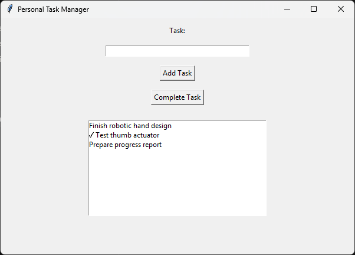

# Task Manager Learning Log

A step-by-step Python learning log that builds the pieces of a personal task manager one concept at a time: dicts, functions, classes, JSON, SQLite and a Tkinter GUI.

[](https://www.python.org/)
[](https://docs.python.org/3/library/tkinter.html)
[](requirements.txt)
[](LICENSE)



## Why I built this

A task manager uses most of the Python basics at once: data modelling, functions, classes, saving to disk, querying a database and a GUI. Learning them all inside one finished app makes it hard to see what each layer does. This log separates them. Every script works on the same small problem, a list of tasks, and adds one new concept, so you can compare the steps side by side.

> **Status:** this is a learning log, not a finished app. Each numbered script is a standalone exercise and they are not wired together yet. See [Known limitations](#known-limitations) and the [Roadmap](#roadmap) for what comes next.

## Learning path

| Step | Script | Concept | What it does |
|------|--------|---------|--------------|
| 1 | [`learning/01_python.py`](learning/01_python.py) | Lists and dicts | Models three tasks as dicts with `name`, `deadline` and `completed`, prints the list and loops over the names. |
| 2 | [`learning/02_functions.py`](learning/02_functions.py) | Functions and shared state | `add_task(name, deadline)` and `delete_task(task_index)` operate on a module-level list. Work in progress (see limitations). |
| 3 | [`learning/03_classes.py`](learning/03_classes.py) | Classes and methods | A `Task` class with `name`, `deadline`, `completed` and a `complete()` method that sets `completed` to `True`. |
| 4 | [`learning/04_json.py`](learning/04_json.py) | File I/O and JSON | Writes a task list to `tasks.json` (pretty-printed with `indent=4`) and reads it back. |
| 5 | [`learning/05_sqlite.py`](learning/05_sqlite.py) | SQLite and dates | Uses a parameterized query to select tasks from `tasks.db` whose deadline is today's ISO date. |
| 6 | [`learning/06_tkinter.py`](learning/06_tkinter.py) | GUI and event handling | A 600x400 Tkinter window to add tasks to a list and mark the selected one as complete. |

## Features

- **Task records as dicts** with `name` / `deadline` / `completed` fields, printed and iterated (step 1).
- **`add_task` and `delete_task` functions** over a shared task list (step 2; `delete_task` currently crashes, see [Known limitations](#known-limitations)).
- **`Task` class** with a `complete()` method (step 3).
- **JSON persistence**: saves a task list to `tasks.json` and loads it back (step 4).
- **"Due today" query** against SQLite using a `?` placeholder and `date.today().isoformat()` (step 5).
- **Tkinter GUI** titled "Personal Task Manager" (step 6):
  - a text entry and an **Add Task** button that ignores empty input and clears the field after adding,
  - a **Complete Task** button that puts a checkmark in front of the selected list item.

### Concepts covered

- Lists, dictionaries, `for` loops and indexing
- Functions, parameters and module-level state (`list.append`, `list.pop`)
- Classes, `__init__`, instance attributes and methods
- Context managers (`with open(...)`), `json.dump` / `json.load`
- `sqlite3` connections and cursors, parameterized SQL (safe against SQL injection), `fetchall`
- `datetime.date` and ISO 8601 date strings
- Tkinter widgets (`Label`, `Entry`, `Button`, `Listbox`), the `pack` geometry manager, button callbacks via `command=` and reading the selection with `curselection()`

## Tech stack

- **Python 3**, standard library only (no third-party packages)
- **tkinter** for the GUI
- **sqlite3** for the database query
- **json** for file persistence
- **datetime** for date handling

## Getting started

### Prerequisites

- Python 3 with Tkinter (developed with Python 3.12).
  - Windows and macOS: the python.org installer includes Tkinter.
  - Debian/Ubuntu: if `python3 -m tkinter` fails, install it with `sudo apt install python3-tk`.
- Git

On macOS and Linux, use `python3` instead of `python` if `python` is not available.

### Installation

```bash
git clone https://github.com/uzairsynth/task-manager-learning-log.git
cd task-manager-learning-log

python -m venv .venv
```

Activate the virtual environment:

```bash
# Windows (PowerShell)
.venv\Scripts\Activate.ps1

# Windows (cmd)
.venv\Scripts\activate.bat

# macOS / Linux
source .venv/bin/activate
```

Install the requirements. The project uses only the standard library, so for now this installs nothing.

```bash
pip install -r requirements.txt
```

### Run the GUI

Run every script **from the repository root**. Steps 4 and 5 open `tasks.json` and `tasks.db` relative to the current directory.

```bash
python learning/06_tkinter.py
```

## Usage walkthrough

Work through the steps in order from the repository root.

```bash
python learning/01_python.py     # prints the task list, then each task name
python learning/02_functions.py  # adds three tasks and prints them (then stops, see limitations)
python learning/03_classes.py    # prints False, then True after task1.complete()
python learning/04_json.py       # writes tasks.json, prints "Tasks saved successfully" and the loaded list
python learning/05_sqlite.py     # prints today's date and the tasks in tasks.db due today
python learning/06_tkinter.py    # opens the GUI
```

Notes on what to expect:

- **Step 4** overwrites `tasks.json` with the same two sample tasks every time it runs.
- **Step 5** prints `[]` unless a task in `tasks.db` is due today. The sample database holds one task due on 2026-09-25. Add a row with today's date to see a match.
- **Step 6**: type a task name and click **Add Task**. To mark a task done, select it in the list and click **Complete Task**, which adds a checkmark. Tasks live in memory only and disappear when you close the window.

### Database schema

`learning/05_sqlite.py` reads an existing `tasks` table. The schema exists only inside the committed `tasks.db`. Here it is for reference:

```sql
CREATE TABLE tasks (
    id        INTEGER PRIMARY KEY AUTOINCREMENT,
    name      TEXT NOT NULL,
    deadline  TEXT,
    completed INTEGER DEFAULT 0
);
```

## Known limitations

These are listed so the log stays accurate. The [Roadmap](#roadmap) covers the fixes.

- `learning/02_functions.py` stops with `NameError: name 'complete_task' is not defined`. `delete_task` calls a `complete_task` function that does not exist yet, so the final `print` never runs. The call also sits inside `delete_task`, so even once that function exists, every delete would also call `complete_task(0)`.
- `learning/05_sqlite.py` needs `tasks.db` in the current directory. Run from anywhere else, it raises `sqlite3.OperationalError: no such table: tasks` and leaves an empty `tasks.db` behind, because no script creates the table.
- `learning/06_tkinter.py` does not save tasks and has no deadline field or delete button. A completed task is marked only by a text prefix, so clicking **Complete Task** on it again adds a second checkmark.
- The scripts are independent exercises. Step 3's `Task` class is not reused, deadlines are plain strings, and the code runs as soon as the file is imported (no `if __name__ == "__main__":` guard).
- There are no automated tests yet.

## Project structure

```text
task-manager-learning-log/
├── docs/
│   └── screenshot.png      # GUI screenshot used in this README
├── learning/
│   ├── 01_python.py        # step 1: lists and dicts
│   ├── 02_functions.py     # step 2: functions
│   ├── 03_classes.py       # step 3: classes
│   ├── 04_json.py          # step 4: JSON save/load
│   ├── 05_sqlite.py        # step 5: SQLite "due today" query
│   └── 06_tkinter.py       # step 6: Tkinter GUI
├── tasks.db                # sample SQLite database used by step 5
├── tasks.json              # sample output written by step 4
├── .gitignore
├── LICENSE
├── README.md
└── requirements.txt        # no packages: standard library only
```

## Roadmap

- [ ] Fix the two broken steps. In step 2, define `complete_task` or remove the stray call. In step 5, add `CREATE TABLE IF NOT EXISTS` plus a seed row so it runs on a fresh clone.
- [ ] Resolve data paths with `pathlib` relative to the script, so it no longer matters where you run it from.
- [ ] Move sample data into `data/` and stop committing files that the scripts regenerate.
- [ ] Combine the steps into one package (`src/task_manager/`): a `Task` dataclass with `datetime.date` deadlines (`models.py`), and a SQLite repository that creates its schema on startup and supports add / list / complete / delete / due-today (`storage.py`).
- [ ] Rebuild the Tkinter GUI on top of the storage layer: saved tasks, a deadline field, a real completed toggle, delete, and highlighting for overdue and due-today tasks.
- [ ] Add an `argparse` CLI with `add`, `list`, `done` and `today` commands.
- [ ] Write pytest tests for the model and storage layers using `tmp_path` or an in-memory SQLite database.
- [ ] Add type hints and docstrings, configure ruff and mypy in `pyproject.toml`, and add pre-commit hooks.
- [ ] Set up GitHub Actions CI running ruff, mypy and pytest on Python 3.11 to 3.13.
- [ ] Package it with `pyproject.toml` and a `ptm` console command (`pip install .`), and add a GIF of the GUI and CLI.
- [ ] Stretch: recurring tasks, `.ics` calendar export, due-today desktop notifications, or a Textual TUI.

## License

Released under the [MIT License](LICENSE).

## Author

**Muhammad Uzair** - [github.com/uzairsynth](https://github.com/uzairsynth)
